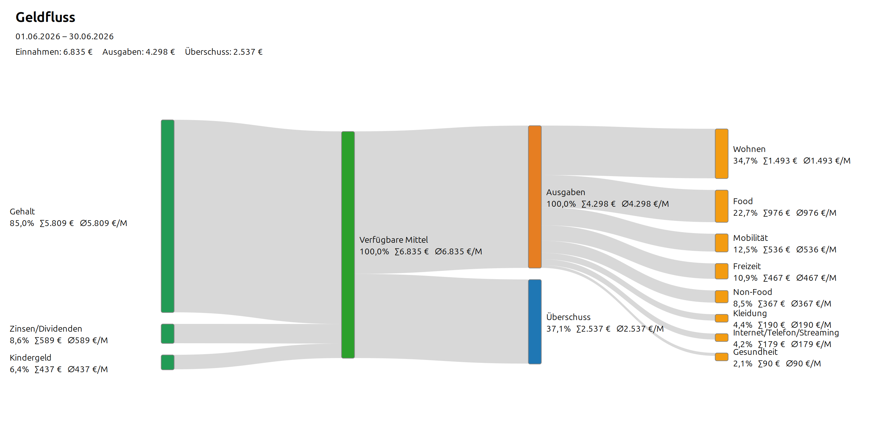
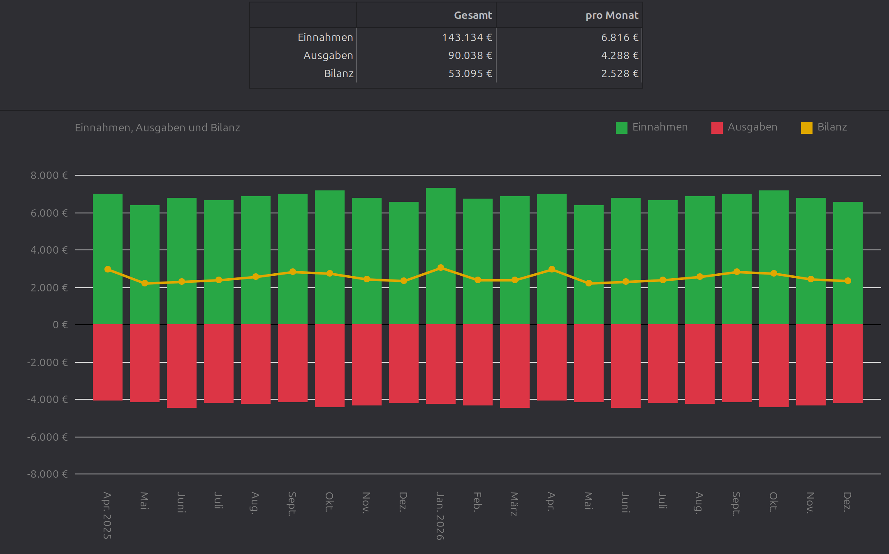
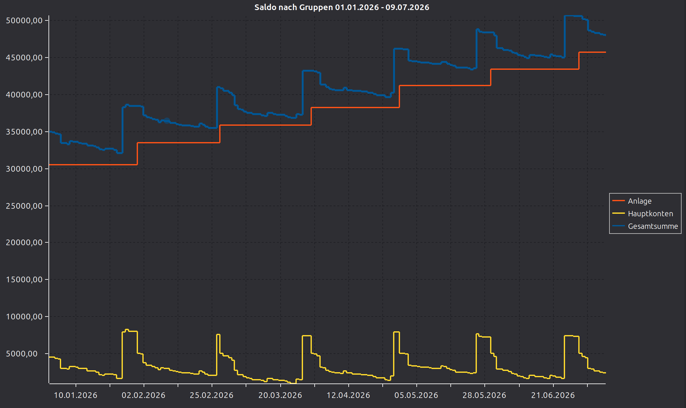

# Erweiterung der Auswertungen

`hibiscus.ly.reports` ergänzt Hibiscus um drei feste, interaktive
Auswertungen. Sie verwenden die in Hibiscus gespeicherten Konten, Umsätze,
Kontogruppen und Umsatzkategorien.

## Geldfluss

Der Geldfluss zeigt, aus welchen Quellen Einnahmen stammen und in welche
Kategorien Ausgaben fließen. Ausgabenkategorien lassen sich per Mausklick
auf- und zuklappen. Kleine Flüsse können in den Einstellungen als
**Sonstige** gebündelt werden.

## Monatsübersicht

Die Monatsübersicht stellt Einnahmen, Ausgaben und Bilanz als Zeitreihe dar;
wahlweise monatlich, quartalsweise oder jährlich gruppiert. Einnahmen werden
als positive Balken, Ausgaben als negative Balken und die Bilanz als Linie
dargestellt.

## Saldo nach Gruppen

Diese Ansicht fasst Kontosalden nach Hibiscus-Kontogruppen zusammen. Konten
ohne Gruppenzuordnung erscheinen unter **Ohne Gruppe**. Bei **Alle Gruppen**
wird zusätzlich die Gesamtsumme angezeigt.

## Abgrenzung zu Reports

Die hier beschriebenen Auswertungen sind fest in das Plugin eingebaut und
werden über eigene Hibiscus-Ansichten bedient. Frei definierbare
HTML-Ausgaben mit Jinjava-Templates sind separat unter
[Reports](README_REPORTS.md) dokumentiert.
